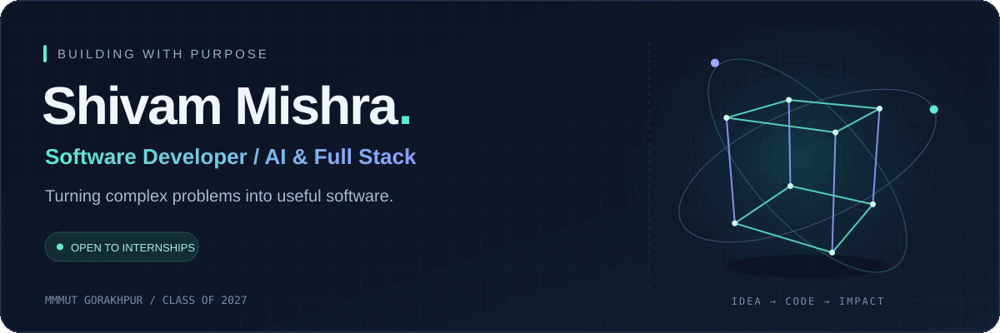
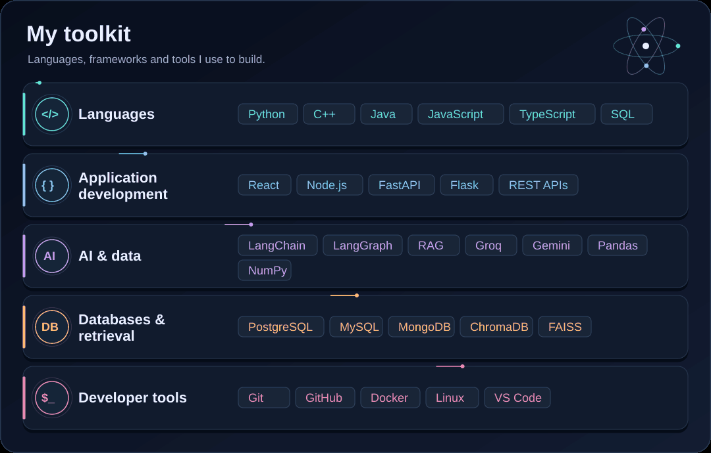
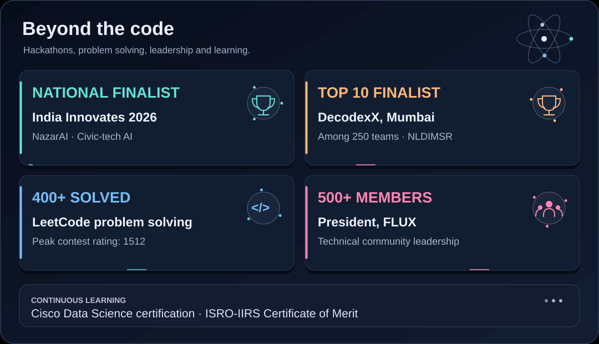
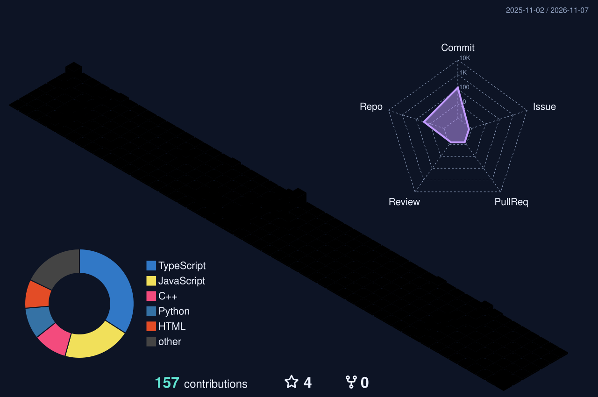

  

  <b>AI systems. Useful products. Thoughtful engineering.</b> 
  I build applications that connect intelligent backends with clear, practical user experiences.

  <a href="mailto:2024022016@mmmut.ac.in"><b>Email me</b></a>
  &nbsp; · &nbsp;
  <a href="https://github.com/shiv9918?tab=repositories"><b>Explore my work</b></a>
  &nbsp; · &nbsp;
  <a href="https://github.com/shiv9918/Leetcode-Practices"><b>DSA practice</b></a>

---

### A little about me

I'm **Shivam**, a developer at **MMMUT Gorakhpur**, graduating in **2027**. My work brings together full-stack development, data science, and generative AI—from conversational data tools to civic-tech applications.

- **Engineering:** Python and FastAPI backends, React interfaces, and database-driven applications.
- **AI:** Retrieval-augmented generation, agent workflows, and natural-language data exploration.
- **Leadership:** President of **FLUX**, a technical community of **500+ members**.
- **Currently exploring:** Reliable AI systems, inference costs, and stronger problem-solving fundamentals.
- **Open to:** Software engineering, backend, full-stack, and AI internship opportunities.

### Selected projects

<table>
<tr>
<td width="50%" valign="top">

#### 01 / NazarAI

**AI for better civic services**

Report civic issues with photos and locations. AI classification, department routing, and WhatsApp updates connect citizens with municipal teams.

`React` `TypeScript` `Node.js` `PostgreSQL` `Gemini` `Twilio`

[Explore repository →](https://github.com/shiv9918/NazarAI)

</td>
<td width="50%" valign="top">

#### 02 / Auto Data Analyst

**From raw data to readable insights**

A modular analysis workflow for data cleaning, exploratory analysis, visualization, AI-generated insights, and reporting.

`Python` `Pandas` `Streamlit` `Groq` `Docker`

[Explore repository →](https://github.com/shiv9918/Auto-Data-Analyst)

</td>
</tr>
<tr>
<td width="50%" valign="top">

#### 03 / Chat with Database

**Ask questions. Explore structured data.**

A conversational interface for databases and uploaded CSV or Excel files, with schema-aware querying and query repair.

`Python` `FastAPI` `Streamlit` `SQLAlchemy` `SQL`

[Explore repository →](https://github.com/shiv9918/Chat_With_Database)

</td>
<td width="50%" valign="top">

#### 04 / ArchiMind

**Understand a codebase as a connected system**

Import a repository to explore its knowledge graph, inspect architecture and health scores, and ask an AI copilot questions grounded in the code.

`Next.js` `TypeScript` `FastAPI` `NetworkX` `Qdrant` `Groq`

[Explore repository →](https://github.com/shiv9918/Archimind)

</td>
</tr>
</table>

### My toolkit

  

<a href="./assets/toolkit.svg">View a still version</a>

<b>Explore my skills — text version</b>

| Area | Technologies |
| :--- | :--- |
| **Languages** | Python · C++ · Java · JavaScript · TypeScript · SQL |
| **Application development** | React · Node.js · FastAPI · Flask · REST APIs |
| **AI & data** | LangChain · LangGraph · RAG · Groq · Gemini · Pandas · NumPy |
| **Databases & retrieval** | PostgreSQL · MySQL · MongoDB · ChromaDB · FAISS |
| **Developer tools** | Git · GitHub · Docker · Linux · VS Code |

### Beyond the code

  

<a href="./assets/highlights.svg">View a still version</a>

<b>Explore my achievements — text version</b>

| Highlight | Details |
| :--- | :--- |
| **India Innovates 2026** | National finalist with NazarAI |
| **DecodexX, Mumbai** | Top 10 finalist among 250 teams at NLDIMSR |
| **Problem solving** | 400+ LeetCode problems solved · Peak contest rating: 1512 |
| **Community leadership** | President, FLUX · Technical community of 500+ members |
| **Learning** | Cisco Data Science certification · ISRO-IIRS Certificate of Merit |

### Contribution activity

  <b>A year of building, one contribution at a time.</b> 
  A 3D view of my GitHub activity, refreshed every 12 hours.

  

<a href="https://github.com/shiv9918/shiv9918/blob/output/activity-still.svg">View the still chart</a> &nbsp; · &nbsp; <a href="https://github.com/shiv9918?tab=overview">Explore activity on GitHub</a>

#### Follow the contribution trail

  <picture>
    <source media="(prefers-color-scheme: dark)" srcset="https://raw.githubusercontent.com/shiv9918/shiv9918/output/github-snake-dark.svg" />
    <source media="(prefers-color-scheme: light)" srcset="https://raw.githubusercontent.com/shiv9918/shiv9918/output/github-snake.svg" />
    
  </picture>

Based on activity visible to GitHub's API. Private activity visibility and refresh timing may affect totals.

---

  <b>Have an interesting problem to solve?</b> 
  I'm happy to connect about internships, hackathons, and useful things we can build together.  
  <a href="mailto:2024022016@mmmut.ac.in"><b>Let's connect →</b></a>

<!-- The hero is stored in this repository, so it does not depend on a third-party image service.
     assets/profile-hero.svg is the editable vector source; profile-hero.gif is the README animation. -->
